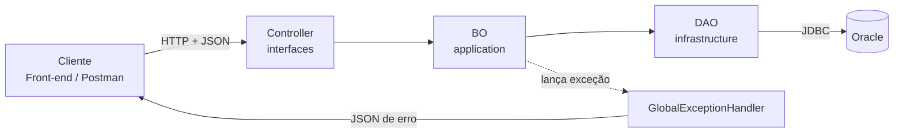
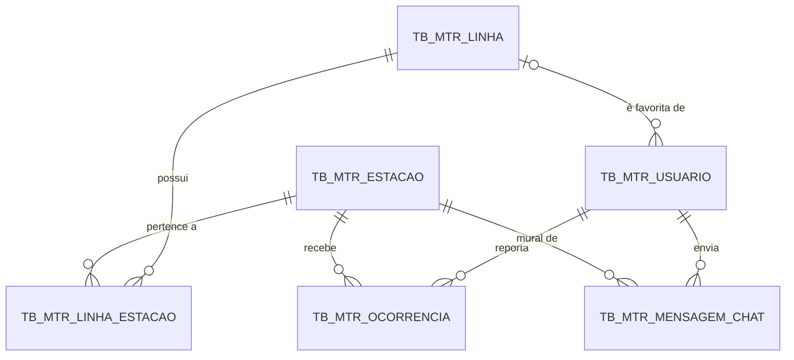

# Mobis — API da Comunidade do Metrô de SP

O **Mobis** é um aplicativo para a comunidade que usa o Metrô de São Paulo. Este repositório contém a sua **API REST**, desenvolvida para a **Global Solution 2026.2 (FIAP)** — tema **CitizenTech**.

O Mobis funciona como uma rede social para quem usa o metrô: os usuários se cadastram, acompanham o **status de cada estação**, **reportam ocorrências** (atrasos, lotação, paralisação, escada rolante parada) e conversam no **mural (chat) de cada estação**.

O diferencial é que **a informação é validada pela própria comunidade**: uma ocorrência só passa a valer depois de receber **3 confirmações** de outros usuários. A partir daí, o status da estação é atualizado automaticamente e o autor ganha pontos de reputação.

| | |
|---|---|
| **API online (Render)** | https://citizentech-4uor.onrender.com |
| **Documentação interativa (Swagger)** | https://citizentech-4uor.onrender.com/swagger-ui.html |
| **Repositório** | https://github.com/RafaelSeiji01/citizentech |

> **Observação:** o deploy usa o plano gratuito do Render, que "dorme" após 15 minutos sem uso. A primeira requisição depois disso pode levar cerca de 1 minuto.

---

## Sumário

- [Integrantes](#integrantes)
- [Tecnologias](#tecnologias)
- [Arquitetura](#arquitetura)
- [Regras de negócio](#regras-de-negócio)
- [Rotas da API](#rotas-da-api)
  - [Usuários](#usuários--usuarios)
  - [Linhas](#linhas--linhas)
  - [Estações](#estações--estacoes)
  - [Ocorrências](#ocorrências--ocorrencias)
  - [Mensagens (chat)](#mensagens-chat--mensagens)
- [Respostas de erro](#respostas-de-erro)
- [Como executar localmente](#como-executar-localmente)
- [Deploy](#deploy)

---

## Integrantes

| Nome | RM |
|---|---|
| Kauê Soares Madarazzo | RM562100 |
| Nicolas Mendes dos Santos | RM566290 |
| Rafael Seiji Aoke Arakaki | RM561993 |
| Rafael Yuji Nakaya | RM563624 |

---

## Tecnologias

| Tecnologia | Uso |
|---|---|
| **Java 21** | Linguagem |
| **Spring Boot 4** (Spring Web MVC) | API REST |
| **Jakarta Bean Validation** | Validação dos dados recebidos (`@NotBlank`, `@Email`, `@Size`...) |
| **JDBC + Oracle Database** | Persistência (servidor Oracle da FIAP), com DAOs escritos à mão |
| **Lombok** | Geração de getters, setters e construtores |
| **springdoc-openapi 3** | Documentação Swagger |
| **Maven** | Build e dependências |
| **Docker + Render** | Deploy |

---

## Arquitetura

O projeto segue as camadas do **Domain Driven Design (DDD)**:

```
com.fiap.citizentech
├── domain                  ← o coração do sistema (não depende de nenhuma outra camada)
│   ├── model               → Usuario, Linha, Estacao, LinhaEstacao, Ocorrencia, MensagemChat
│   └── exception           → RegraNegocioException, RecursoNaoEncontradoException
├── application             ← casos de uso e regras de negócio
│   └── bo                  → UsuarioBO, LinhaBO, EstacaoBO, OcorrenciaBO, MensagemChatBO
├── infrastructure          ← detalhes técnicos
│   ├── database            → ConnectionFactory (conexão JDBC com o Oracle)
│   ├── dao                 → UsuarioDAO, LinhaDAO, LinhaEstacaoDAO, EstacaoDAO, OcorrenciaDAO, MensagemChatDAO
│   └── config              → CorsConfig
└── interfaces              ← porta de entrada HTTP
    ├── controller          → UsuarioController, LinhaController, EstacaoController, OcorrenciaController, MensagemChatController
    ├── dto                 → LoginRequest, StatusRequest, TextoRequest
    └── handler             → GlobalExceptionHandler, ErroResponse
```

Fluxo de uma requisição:



| Camada | Responsabilidade |
|---|---|
| **Controller** | Recebe a requisição HTTP, valida o JSON (`@Valid`) e devolve a resposta com o status correto. Não tem regra de negócio. |
| **BO** | Aplica as regras de negócio e lança exceções quando algo não é permitido. Não tem SQL. |
| **DAO** | Único lugar com SQL. Usa `PreparedStatement` (protege contra SQL Injection) e *try-with-resources* (fecha as conexões). Operações com várias etapas usam **transação** (`commit`/`rollback`). |
| **Model** | Representa os conceitos do domínio e seus comportamentos (ex.: `adicionarReputacao`, `isConfirmada`). |

### Modelo de dados



A relação **linha ↔ estação é N:N**: uma estação de integração (ex.: Sé) pertence a mais de uma linha. A tabela associativa `TB_MTR_LINHA_ESTACAO` guarda também a **posição da estação no trajeto** (`NR_ORDEM`).

---

## Regras de negócio

### Ocorrências — validação pela comunidade

```
 registrar                3ª confirmação                 resolver
──────────► ATIVA (não confirmada) ─────────► ATIVA (confirmada) ─────────► RESOLVIDA
             não afeta a estação              muda o status da estação      a estação é recalculada
                                              autor ganha +10 de reputação
```

- Toda ocorrência nasce **ATIVA**, com **0 confirmações**.
- Ela é considerada **confirmada** quando está ATIVA e tem **3 ou mais confirmações**.
- Na **3ª confirmação**, o autor ganha **10 pontos de reputação** (uma única vez).
- Uma ocorrência **RESOLVIDA** não pode mais ser confirmada.

### Status da estação (calculado automaticamente)

Sempre que uma ocorrência é confirmada, resolvida ou excluída, o status da estação é recalculado a partir das ocorrências **confirmadas**:

| Ocorrência confirmada na estação | Status da estação |
|---|---|
| `PARALISACAO` | **PARALISADA** (prioridade máxima) |
| `ATRASO` ou `LOTACAO` | **LENTIDAO** |
| `ESCADA_ROLANTE` | **ATENCAO** |
| nenhuma | **NORMAL** |

### Demais regras

| Recurso | Regras |
|---|---|
| **Usuário** | E-mail único · reputação começa em 0 e nunca fica negativa · a senha nunca aparece nas respostas · linha favorita é opcional, mas precisa existir |
| **Linha** | Número entre 1 e 99 e único · não pode ser excluída enquanto tiver estações |
| **Estação** | Nome único (cada estação existe uma vez só) · status inicial `NORMAL` |
| **Linha × Estação** | A mesma estação não pode aparecer duas vezes na mesma linha · duas estações não podem ocupar a mesma posição na linha |
| **Mensagem** | Usuário e estação precisam existir · texto entre 1 e 500 caracteres · data/hora definida pelo servidor |
| **Exclusões** | Excluir um usuário ou uma estação remove também os registros ligados a ele (em uma única transação) |

---

## Rotas da API

URL base local: `http://localhost:8080` · URL base online: `https://citizentech-4uor.onrender.com`

### Visão geral

| Método | Rota | Descrição |
|---|---|---|
| `POST` | `/usuarios` | Cadastra um usuário |
| `POST` | `/usuarios/login` | Faz login |
| `GET` | `/usuarios` | Lista os usuários (ranking de reputação) |
| `GET` | `/usuarios/{id}` | Busca um usuário |
| `PUT` | `/usuarios/{id}` | Edita o perfil |
| `PUT` | `/usuarios/{id}/reputacao?pontos=N` | Soma ou subtrai pontos de reputação |
| `DELETE` | `/usuarios/{id}` | Exclui um usuário |
| `GET` | `/linhas` | Lista as linhas |
| `GET` | `/linhas/{id}` | Busca uma linha |
| `POST` | `/linhas` | Cadastra uma linha |
| `PUT` | `/linhas/{id}` | Edita uma linha |
| `DELETE` | `/linhas/{id}` | Exclui uma linha |
| `GET` | `/linhas/{id}/estacoes` | Trajeto da linha, na ordem |
| `POST` | `/linhas/{id}/estacoes` | Adiciona uma estação à linha |
| `DELETE` | `/linhas/{idLinha}/estacoes/{idEstacao}` | Remove uma estação da linha |
| `GET` | `/estacoes` | Lista as estações |
| `GET` | `/estacoes/{id}` | Busca uma estação |
| `POST` | `/estacoes` | Cadastra uma estação |
| `PUT` | `/estacoes/{id}/status` | Altera o status manualmente |
| `DELETE` | `/estacoes/{id}` | Exclui uma estação |
| `GET` | `/ocorrencias/estacao/{idEstacao}` | Ocorrências de uma estação |
| `POST` | `/ocorrencias` | Reporta uma ocorrência |
| `PUT` | `/ocorrencias/{id}/confirmar` | Confirma uma ocorrência |
| `PUT` | `/ocorrencias/{id}/resolver` | Marca a ocorrência como resolvida |
| `DELETE` | `/ocorrencias/{id}` | Exclui uma ocorrência |
| `GET` | `/mensagens/estacao/{idEstacao}` | Histórico do chat da estação |
| `POST` | `/mensagens` | Envia uma mensagem |
| `PUT` | `/mensagens/{id}` | Edita uma mensagem |
| `DELETE` | `/mensagens/{id}` | Exclui uma mensagem |

---

### Usuários — `/usuarios`

#### `POST /usuarios` — Cadastrar usuário
Cria a conta. O usuário começa com **0 pontos de reputação**. A linha favorita é opcional.

```json
{
  "nome": "Ana Souza",
  "email": "ana@email.com",
  "senha": "123456",
  "idLinhaFavorita": 1
}
```

**201 Created** — a senha **não** é devolvida:
```json
{ "id": 2, "nome": "Ana Souza", "email": "ana@email.com", "pontosReputacao": 0, "idLinhaFavorita": 1 }
```

| Erro | Quando |
|---|---|
| `400` | Campos inválidos (nome vazio, e-mail inválido, senha com menos de 6 caracteres) ou e-mail já cadastrado |
| `404` | `idLinhaFavorita` não existe |

#### `POST /usuarios/login` — Login
Confere e-mail e senha e devolve os dados do usuário (o front-end pode guardá-los para entrar automaticamente da próxima vez).

```json
{ "email": "ana@email.com", "senha": "123456" }
```

**200 OK** — dados do usuário · **400** — "E-mail ou senha inválidos" (por segurança, não informa qual dos dois está errado).

#### `GET /usuarios` — Listar usuários
Lista todos os usuários **ordenados pela reputação** (do maior para o menor) — serve como **ranking da comunidade**.

**200 OK** — lista de usuários.

#### `GET /usuarios/{id}` — Buscar usuário
**200 OK** — dados do usuário · **404** — usuário não encontrado.

#### `PUT /usuarios/{id}` — Editar perfil
Atualiza nome, e-mail, senha e linha favorita. O corpo é igual ao do cadastro.

**200 OK** — usuário atualizado · **400** — dados inválidos ou e-mail já usado por outra pessoa · **404** — usuário ou linha não encontrados.

#### `PUT /usuarios/{id}/reputacao?pontos=N` — Ajustar reputação
Soma (ou subtrai, se `N` for negativo) pontos de reputação. A reputação nunca fica abaixo de zero.

Exemplo: `PUT /usuarios/2/reputacao?pontos=5` · **200 OK** — usuário com a nova reputação · **404** — usuário não encontrado.

#### `DELETE /usuarios/{id}` — Excluir usuário
Exclui o usuário **e as mensagens e ocorrências que ele criou**, em uma única transação.

**204 No Content** · **404** — usuário não encontrado.

---

### Linhas — `/linhas`

#### `GET /linhas` — Listar linhas
Lista as linhas do metrô ordenadas pelo número.

**200 OK**:
```json
[
  { "id": 1, "numero": 1, "nome": "Azul", "cor": "#0455A1" },
  { "id": 2, "numero": 2, "nome": "Verde", "cor": "#007E5E" }
]
```

#### `GET /linhas/{id}` — Buscar linha
**200 OK** — dados da linha · **404** — linha não encontrada.

#### `POST /linhas` — Cadastrar linha
```json
{ "numero": 6, "nome": "Laranja", "cor": "#F68D1E" }
```
**201 Created** · **400** — número fora de 1 a 99, número já usado ou campos vazios.

#### `PUT /linhas/{id}` — Editar linha
Mesmo corpo do cadastro. **200 OK** · **400** — dados inválidos ou número já usado por outra linha · **404** — linha não encontrada.

#### `DELETE /linhas/{id}` — Excluir linha
Só é permitido se a linha **não tiver estações**. Os usuários que tinham essa linha como favorita ficam sem linha favorita.

**204 No Content** · **400** — a linha ainda possui estações · **404** — linha não encontrada.

#### `GET /linhas/{id}/estacoes` — Trajeto da linha
Devolve as estações da linha **na ordem do trajeto**, com o nome e o status atual de cada uma. É a rota usada para **desenhar o mapa**.

**200 OK**:
```json
[
  { "idLinha": 1, "idEstacao": 13, "ordem": 1, "nomeEstacao": "Tucuruvi", "statusEstacao": "NORMAL" },
  { "idLinha": 1, "idEstacao": 14, "ordem": 2, "nomeEstacao": "Parada Inglesa", "statusEstacao": "NORMAL" }
]
```
**404** — linha não encontrada.

#### `POST /linhas/{id}/estacoes` — Adicionar estação à linha
Liga uma estação já cadastrada à linha, em uma posição do trajeto.

```json
{ "idEstacao": 5, "ordem": 3 }
```
**201 Created** — a ligação, já com nome e status da estação · **400** — a estação já está na linha, a posição já está ocupada ou a ordem é inválida · **404** — linha ou estação não encontradas.

#### `DELETE /linhas/{idLinha}/estacoes/{idEstacao}` — Remover estação da linha
Remove **apenas a ligação** — a estação continua existindo e continua nas outras linhas.

**204 No Content** · **404** — a estação não pertence a essa linha.

---

### Estações — `/estacoes`

#### `GET /estacoes` — Listar estações
Lista todas as estações em **ordem alfabética**. Para ver as estações de uma linha na ordem do trajeto, use `GET /linhas/{id}/estacoes`.

**200 OK**:
```json
[
  { "id": 3, "nome": "Ana Rosa", "statusAtual": "NORMAL" },
  { "id": 4, "nome": "Luz", "statusAtual": "LENTIDAO" }
]
```

#### `GET /estacoes/{id}` — Buscar estação
**200 OK** — dados da estação · **404** — estação não encontrada.

#### `POST /estacoes` — Cadastrar estação
Se o status não for informado, a estação começa como `NORMAL`. Depois de criada, use `POST /linhas/{id}/estacoes` para colocá-la em uma linha.

```json
{ "nome": "Brasilândia" }
```
**201 Created** · **400** — nome vazio, nome já cadastrado ou status inválido.

#### `PUT /estacoes/{id}/status` — Alterar status manualmente
Uso administrativo. Status aceitos: `NORMAL`, `ATENCAO`, `LENTIDAO`, `PARALISADA`.

```json
{ "status": "LENTIDAO" }
```
**200 OK** — estação atualizada · **400** — status inválido · **404** — estação não encontrada.

> O status também é recalculado automaticamente pelas ocorrências confirmadas (ver [Regras de negócio](#regras-de-negócio)).

#### `DELETE /estacoes/{id}` — Excluir estação
Exclui a estação **e as suas ligações com linhas, mensagens e ocorrências**, em uma única transação.

**204 No Content** · **404** — estação não encontrada.

---

### Ocorrências — `/ocorrencias`

Tipos aceitos: `LOTACAO`, `ATRASO`, `PARALISACAO`, `ESCADA_ROLANTE`.

#### `GET /ocorrencias/estacao/{idEstacao}` — Ocorrências da estação
Lista as ocorrências da estação, **das mais recentes para as mais antigas**. O campo `confirmada` indica se a ocorrência já foi validada pela comunidade.

**200 OK**:
```json
[
  {
    "id": 1, "idUsuario": 2, "idEstacao": 1,
    "tipo": "ATRASO", "descricao": "Trem parado há 10 minutos",
    "dataHora": "2026-11-19T08:15:00", "confirmacoes": 3,
    "status": "ATIVA", "confirmada": true
  }
]
```
**404** — estação não encontrada.

#### `POST /ocorrencias` — Reportar ocorrência
A ocorrência começa **ATIVA**, com **0 confirmações**. Data, confirmações e status são definidos pelo sistema.

```json
{ "idUsuario": 2, "idEstacao": 1, "tipo": "ATRASO", "descricao": "Trem parado há 10 minutos" }
```
**201 Created** · **400** — tipo inválido ou campos obrigatórios ausentes · **404** — usuário ou estação não encontrados.

#### `PUT /ocorrencias/{id}/confirmar` — Confirmar ocorrência
"Eu também estou vendo isso." Soma 1 confirmação. Na **3ª**, a ocorrência passa a ser **confirmada**, o **status da estação é atualizado** e o autor ganha **10 pontos**.

**200 OK** — ocorrência atualizada · **400** — a ocorrência já foi resolvida · **404** — ocorrência não encontrada.

#### `PUT /ocorrencias/{id}/resolver` — Resolver ocorrência
Marca o problema como **RESOLVIDO**. A ocorrência fica no histórico e o status da estação é recalculado (pode voltar a `NORMAL`).

**200 OK** · **400** — já estava resolvida · **404** — ocorrência não encontrada.

#### `DELETE /ocorrencias/{id}` — Excluir ocorrência
Para ocorrências falsas ou cadastradas por engano. O status da estação é recalculado.

**204 No Content** · **404** — ocorrência não encontrada.

---

### Mensagens (chat) — `/mensagens`

#### `GET /mensagens/estacao/{idEstacao}` — Histórico do chat
Lista as mensagens do mural da estação, **das mais antigas para as mais novas** (como em um chat), já com o nome de quem escreveu.

**200 OK**:
```json
[
  {
    "id": 1, "idUsuario": 2, "idEstacao": 1, "nomeUsuario": "Ana Souza",
    "texto": "Trem parado na Sé", "dataHora": "2026-11-19T08:16:30"
  }
]
```
**404** — estação não encontrada.

#### `POST /mensagens` — Enviar mensagem
A data/hora é definida pelo servidor.

```json
{ "idUsuario": 2, "idEstacao": 1, "texto": "Trem parado na Sé" }
```
**201 Created** · **400** — texto vazio ou com mais de 500 caracteres · **404** — usuário ou estação não encontrados.

#### `PUT /mensagens/{id}` — Editar mensagem
```json
{ "texto": "Trem voltou a andar" }
```
**200 OK** · **400** — texto vazio ou com mais de 500 caracteres · **404** — mensagem não encontrada.

#### `DELETE /mensagens/{id}` — Excluir mensagem
**204 No Content** · **404** — mensagem não encontrada.

---

## Respostas de erro

Todos os erros seguem o mesmo formato, gerado pelo `GlobalExceptionHandler`:

```json
{
  "dataHora": "2026-11-19T08:20:00",
  "status": 400,
  "erro": "Bad Request",
  "mensagem": "Dados inválidos",
  "detalhes": [
    "nome: O nome é obrigatório",
    "email: E-mail inválido"
  ]
}
```

| Status | Quando acontece |
|---|---|
| `200 OK` | Consulta ou atualização feita com sucesso |
| `201 Created` | Registro criado |
| `204 No Content` | Registro excluído |
| `400 Bad Request` | Dados inválidos, JSON mal formatado ou regra de negócio violada |
| `404 Not Found` | Registro ou rota inexistente |
| `405 Method Not Allowed` | Método HTTP não suportado na rota |
| `500 Internal Server Error` | Erro no banco de dados ou erro inesperado |

---

## ▶ Como executar localmente

### Pré-requisitos
- **Java JDK 21**
- **IntelliJ IDEA** (ou outra IDE com suporte a Maven)
- Acesso ao **Oracle** (servidor da FIAP: `oracle.fiap.com.br:1521:ORCL`)
- **SQL Developer** (para criar as tabelas)

### 1. Banco de dados
Execute os scripts SQL do projeto no SQL Developer (com **F5**), nesta ordem:
1. Criação das tabelas (DDL)
2. Dados iniciais (DML)
3. Carga da rede do Metrô (`carga_rede_metro_sp.sql`) — 8 linhas, 99 estações

### 2. Variáveis de ambiente
A senha do banco **não** fica no código. Configure as variáveis abaixo (no IntelliJ: *Run → Edit Configurations → Environment variables*):

| Variável | Obrigatória | Exemplo |
|---|---|---|
| `DB_USER` | Sim | `rm99999` |
| `DB_PASSWORD` | Sim | `sua_senha` |
| `DB_URL` | | padrão: `jdbc:oracle:thin:@oracle.fiap.com.br:1521:ORCL` |
| `PORT` | | padrão: `8080` |

### 3. Executar
```bash
git clone https://github.com/RafaelSeiji01/citizentech.git
cd citizentech
./mvnw spring-boot:run
```
Ou abra o projeto no IntelliJ e execute a classe `CitizentechApplication`.

A API sobe em `http://localhost:8080` e o Swagger fica em `http://localhost:8080/swagger-ui.html`.

---

## Deploy

A aplicação está publicada no **Render**, usando o `Dockerfile` da raiz do projeto:

1. **Etapa de build:** imagem `maven:3.9-eclipse-temurin-21` compila o projeto e gera o `citizentech.jar`.
2. **Etapa de execução:** imagem `eclipse-temurin:21-jre` roda o `.jar`.

Variáveis configuradas no Render: `DB_USER`, `DB_PASSWORD` e `TZ=America/Sao_Paulo` (horário de Brasília nas datas).

https://citizentech-4uor.onrender.com/swagger-ui.html
